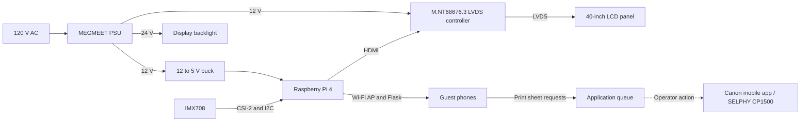

# Magic Mirror Photo Booth

**Python · Embedded Linux · Hardware integration · Raspberry Pi · LVDS · Local networking**

A secondhand lululemon Studio Mirror was reverse-engineered and rebuilt into a self-service photo booth. A Raspberry Pi 4 (4 GB) manages the Sony IMX708 camera, local Wi-Fi access point, bilingual guest web interface, and the mirror kiosk; a replacement LVDS controller drives the original display.

**Built for a real deadline:** software was developed remotely while the mirror was in another country; physical integration and troubleshooting happened in the final days before a scheduled event. The project was used at a California quinceañera on **November 14, 2026**. Guests captured and downloaded photos independently; physical printing used a separate operator-assisted Canon app workflow.

**What was demonstrated:** hardware adaptation, browser-based control from guest phones, camera capture and framed-image output, session management, iOS captive-browser handling, print-sheet selection, and field operation in an event setting. See [field evidence and its limits](docs/FIELD_EVIDENCE.md).

**What was not measured:** exact event uptime, total guest sessions, capture count and confirmed physical print count. These may be investigated using retained files and records; the photographs alone do not establish them.

**Code now included:** [Full version 20 Python application — sanitized public derivative](src/booth20.py) (**~6,000 lines**). The original deployed file was provided in full and passed a Python syntax check. This derivative removes known embedded credentials and includes targeted changes explained below. **It has not been verified on the physical Raspberry Pi.**


## Features

- Embedded Flask app with bilingual Spanish/English guest interface and configurable mirror display
- Local Wi-Fi/captive-portal experience and QR connection flow, with iOS and Android-specific workarounds
- Separate guest visits and mirror ownership; 15 s inactivity release plus 20 s capture watchdog
- Camera capture using `picamera2`/libcamera; real-time calibration and admin preview
- 4×6-inch print sheet composition (vertical 2×2), manual Canon handoff and optional CUPS queue mode
- Admin panel for event settings, camera health, print queue, media and maintenance

## Architecture



## Repository contents

```text
magic-mirror-photo-booth/
├── src/booth20.py              # full sanitized Python application
├── docs/                       # architecture, hardware, testing, deployment, security
├── tests/                      # static review tests (not the original 293 checks)
├── tools/photo_inventory.py    # read-only photo inventory utility
├── assets/README.md            # safe media upload guidance
├── .gitignore                  # excludes credentials and private event media
└── PUBLISHING_CHECKLIST.md
```

## Source provenance and public changes

This project includes a **public code variant**, not an exact-byte copy of the field-deployed code. Targeted changes:

1. Remove known embedded PIN and Wi-Fi password; initialize the PIN from local device settings or generate an 8-digit PIN on first run.
2. Use an opaque admin session cookie rather than putting the PIN in the cookie.
3. Prevent anonymous network access to all JPEGs by filename on `/fotos`.
4. Avoid re-acquiring the non-reentrant camera lock during camera recovery.

See [full-source review](docs/BOOTH20_SOURCE_REVIEW.md) and [security notes](docs/SECURITY.md). **Changes remain untested on the physical booth; back up the deployed version before testing.**

## Engineering decisions under deadline

The 6,000-line Python application is a **monolithic implementation**, not a recommended final product architecture. Keeping a known-working, integrated program during final on-site commissioning reduced the immediate risks of a major refactor with limited access to the physical hardware. This is a **contextual engineering trade-off**, not evidence that modularity is unnecessary.

The code contains distinct responsibilities—camera handling, session ownership, local networking, print composition, administrative controls and embedded browser templates—but they are not cleanly isolated as deployable modules. See [engineering trade-offs](docs/ENGINEERING_DECISIONS.md) for the rationale, consequences and modularization plan.

## Field evidence

- **Finished image samples:** demonstrate camera capture and event-caption compositing, not uptime or total throughput.
- **Guest photographed at the live event:** documents real-world use of the mirror outside a development setting.
- **Mirror running in the enclosure:** shows physical kiosk integration; QR code and location details must be reviewed before publication.
- **iPhone captive browser viewer and print-sheet dialog:** demonstrate the mobile UI and handoff screens on actual iOS hardware, not confirmed paper output.

Identifiable guest photographs and event details are **not included** until permission and privacy review are complete. [Evidence map](docs/FIELD_EVIDENCE.md).

## Development and verification

The engineering portfolio reports 293 automated checks and a 12-second, 50-client simulation on a development machine, *not* the Raspberry Pi. The original 293-check test harness was not included in the upload and has **not** been rerun. The public Python source has been syntax-checked here.

The photo capture, printing, hardware recovery, real Wi-Fi portal and true simultaneous client behavior require validation on an actual Raspberry Pi.

## Hardware and installation

- Raspberry Pi 4, Sony IMX708 camera, 40-inch LVDS display and M.NT68676.3
- Raspberry Pi OS with `picamera2`/libcamera support, Flask, Pillow, `qrcode[pil]`
- NetworkManager shared-mode access point, set up separately from the Python app

See [running and configuration notes](docs/RUNNING.md) before executing.

## Documentation

- [Architecture](docs/ARCHITECTURE.md) · [Hardware](docs/HARDWARE.md) · [Session model](docs/SESSION_MODEL.md)
- [Source review](docs/BOOTH20_SOURCE_REVIEW.md) · [Testing](docs/TESTING.md) · [Deployment](docs/DEPLOYMENT.md)
- [Event metrics recovery](docs/EVENT_DATA_RECOVERY.md) · [Results](docs/RESULTS.md) · [Security](docs/SECURITY.md)
- [Engineering decisions](docs/ENGINEERING_DECISIONS.md) · [Field evidence](docs/FIELD_EVIDENCE.md) · [Roadmap](docs/ROADMAP.md)
- [Source README](src/README.md) · [Publishing checklist](PUBLISHING_CHECKLIST.md)

## Author

Jesús Erubiel Borboa García · Mechatronics Engineering, Universidad Politécnica de Sinaloa (UPSIN), Mexico.

No open-source license selected yet. Deployment configurations, captured guest photos, secrets and event data are not included.