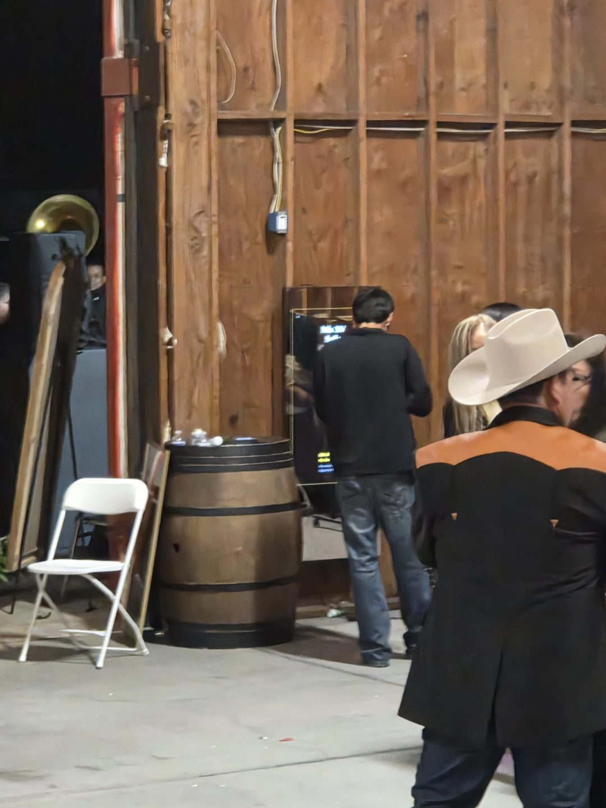
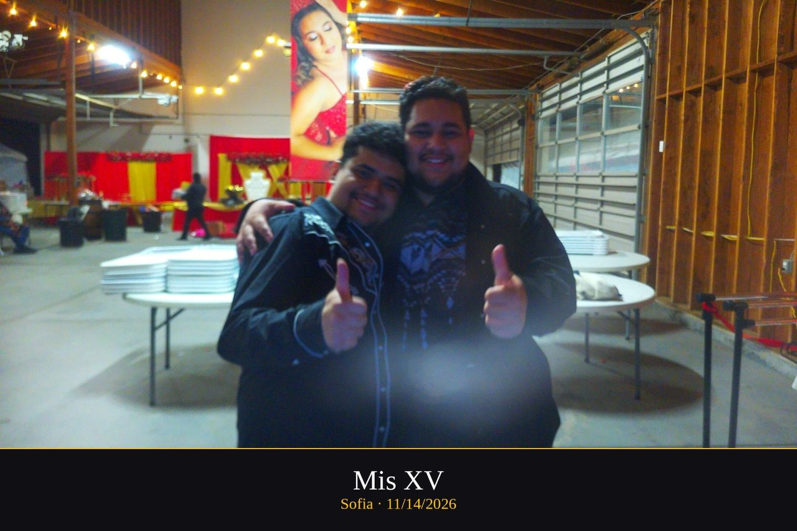
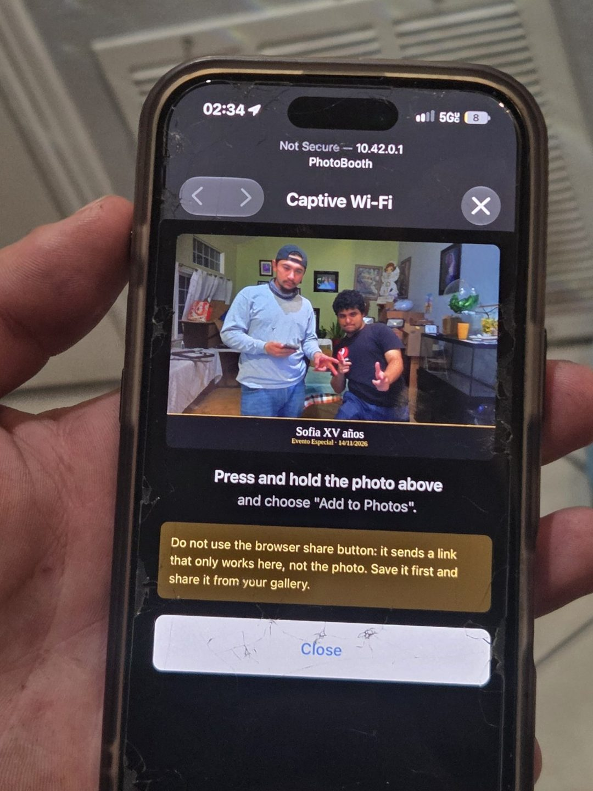
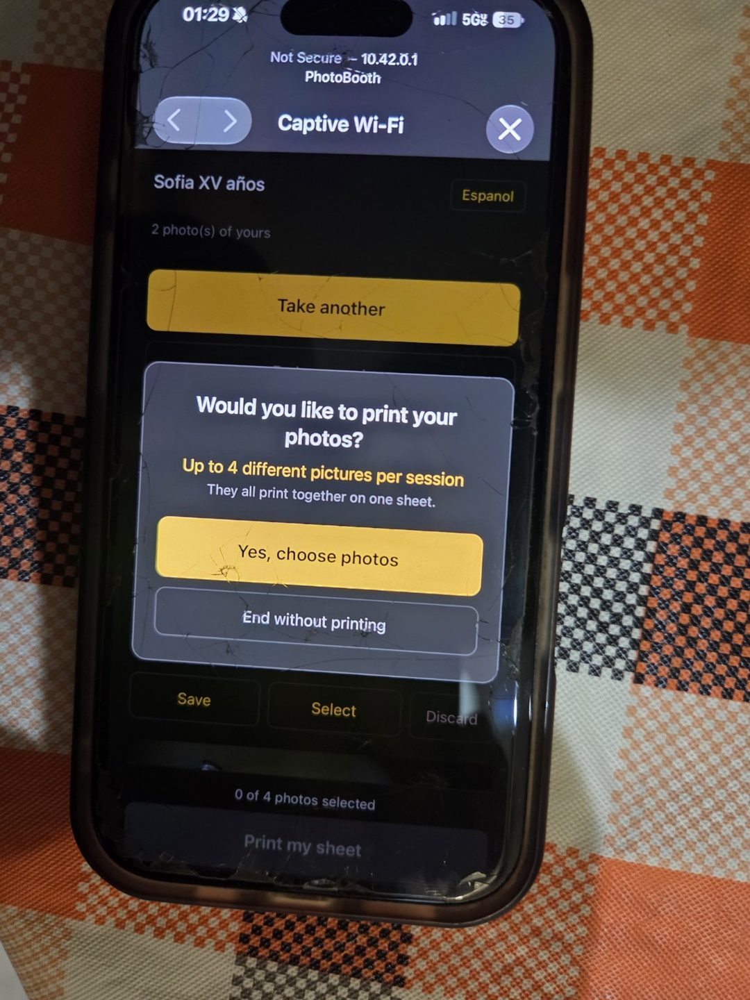
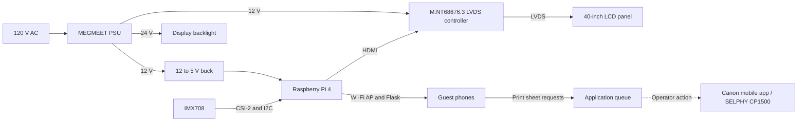

# Magic Mirror Photo Booth

**Python · Embedded Linux · Hardware integration · Raspberry Pi · LVDS · Local networking**

A secondhand lululemon Studio Mirror was repurposed into a self-service event photo booth. The system integrates a **Raspberry Pi 4**, **Sony IMX708 camera**, replacement **LVDS display controller**, an offline guest Wi-Fi network, and a bilingual browser-based interface.

**Built under a fixed deadline:** software development took place remotely while the mirror hardware was in California. Physical integration, troubleshooting and commissioning were completed in the final days before a scheduled event. The system was deployed at a quinceañera on **November 14, 2026**, where guests used the capture and download workflow on their phones. Physical printing followed a separate, operator-assisted Canon app workflow.

**Source:** [Full version 20 application (sanitized public derivative)](src/booth20.py) · [Engineering decisions](docs/ENGINEERING_DECISIONS.md) · [Field evidence](docs/FIELD_EVIDENCE.md)

## Field deployment and mobile interface

| Live event use | Captured image and event frame |
|:---:|:---:|
|  |  |

| iPhone photo-saving interface | iPhone print-sheet selection |
|:---:|:---:|
|  |  |

*Photographs from real operation and device testing, shared with permission. They demonstrate the physical deployment, output-image composition and rendered mobile workflows. The total number of captures and completed prints will be added when verified from the Raspberry Pi and operator records.*

## Engineering highlights

- **Hardware reuse:** integrated a replacement LCD controller, camera, power conversion and existing smart-mirror display.
- **Shared-resource control:** separated temporary mirror ownership from longer guest photo sessions so visitors could review photos without blocking the next capture.
- **Mobile-first local networking:** QR onboarding, an offline access point, captive portal behavior and iOS-specific save workflows.
- **Operational delivery:** tested the integrated system, addressed hardware failures and deployed it for an actual event despite a short final integration window.

The public source includes targeted security and camera-recovery changes made after the event. These changes are documented but **not yet verified on the physical Raspberry Pi**; the field-deployed build and public derivative should not be treated as identical.

## Features

- Embedded Flask app with bilingual Spanish/English guest interface and configurable mirror display
- Local Wi-Fi/captive-portal experience and QR connection flow, with iOS and Android-specific workarounds
- Separate guest visits and mirror ownership; 15 s inactivity release plus 20 s capture watchdog
- Camera capture using `picamera2`/libcamera; real-time calibration and admin preview
- 4×6-inch print sheet composition (vertical 2×2), manual Canon handoff and optional CUPS queue mode
- Admin panel for event settings, camera health, print queue, media and maintenance

## Architecture



## Repository contents

```text
magic-mirror-photo-booth/
├── src/booth20.py              # full sanitized Python application
├── docs/                       # architecture, hardware, testing, deployment, security
├── tests/                      # static review tests (not the original 293 checks)
├── tools/photo_inventory.py    # read-only photo inventory utility
├── assets/gallery/              # four approved event/UI photographs
├── assets/GALLERY.md           # visual-evidence captions and context
├── .gitignore                  # excludes credentials and private event media
└── PUBLISHING_CHECKLIST.md
```

## Source provenance and public changes

This project includes a **public code variant**, not an exact-byte copy of the field-deployed code. Targeted changes:

1. Remove known embedded PIN and Wi-Fi password; initialize the PIN from local device settings or generate an 8-digit PIN on first run.
2. Use an opaque admin session cookie rather than putting the PIN in the cookie.
3. Prevent anonymous network access to all JPEGs by filename on `/fotos`.
4. Avoid re-acquiring the non-reentrant camera lock during camera recovery.

See [full-source review](docs/BOOTH20_SOURCE_REVIEW.md) and [security notes](docs/SECURITY.md). **Changes remain untested on the physical booth; back up the deployed version before testing.**

## Engineering decisions under deadline

The 6,000-line Python application is a **monolithic implementation**, not a recommended final product architecture. Keeping a known-working, integrated program during final on-site commissioning reduced the immediate risks of a major refactor with limited access to the physical hardware. This is a **contextual engineering trade-off**, not evidence that modularity is unnecessary.

The code contains distinct responsibilities—camera handling, session ownership, local networking, print composition, administrative controls and embedded browser templates—but they are not cleanly isolated as deployable modules. See [engineering trade-offs](docs/ENGINEERING_DECISIONS.md) for the rationale, consequences and modularization plan.

## How to interpret the field results

The photographs document actual operation and visible outputs; the development tests provide complementary software-level verification. Observed event use is valuable field evidence without implying a precisely measured uptime percentage or print count. See the [photo gallery](assets/GALLERY.md), [deployment record](docs/DEPLOYMENT.md) and [testing methodology](docs/TESTING.md).

## Development and verification

The engineering portfolio reports 293 automated checks and a 12-second, 50-client simulation on a development machine, *not* the Raspberry Pi. The original 293-check test harness was not included in the upload and has **not** been rerun. The public Python source has been syntax-checked here.

The photo capture, printing, hardware recovery, real Wi-Fi portal and true simultaneous client behavior require validation on an actual Raspberry Pi.

## Hardware and installation

- Raspberry Pi 4, Sony IMX708 camera, 40-inch LVDS display and M.NT68676.3
- Raspberry Pi OS with `picamera2`/libcamera support, Flask, Pillow, `qrcode[pil]`
- NetworkManager shared-mode access point, set up separately from the Python app

See [running and configuration notes](docs/RUNNING.md) before executing.

## Documentation

- [Architecture](docs/ARCHITECTURE.md) · [Hardware](docs/HARDWARE.md) · [Session model](docs/SESSION_MODEL.md)
- [Source review](docs/BOOTH20_SOURCE_REVIEW.md) · [Testing](docs/TESTING.md) · [Deployment](docs/DEPLOYMENT.md)
- [Event metrics recovery](docs/EVENT_DATA_RECOVERY.md) · [Results](docs/RESULTS.md) · [Security](docs/SECURITY.md)
- [Engineering decisions](docs/ENGINEERING_DECISIONS.md) · [Field evidence](docs/FIELD_EVIDENCE.md) · [Photo gallery](assets/GALLERY.md) · [Roadmap](docs/ROADMAP.md)
- [Source README](src/README.md) · [Publishing checklist](PUBLISHING_CHECKLIST.md)

## Author

Jesús Erubiel Borboa García · Mechatronics Engineering, Universidad Politécnica de Sinaloa (UPSIN), Mexico.

No open-source license selected yet. Private runtime configurations, credentials and the full event photo archive are not included; the four approved gallery images are published above.