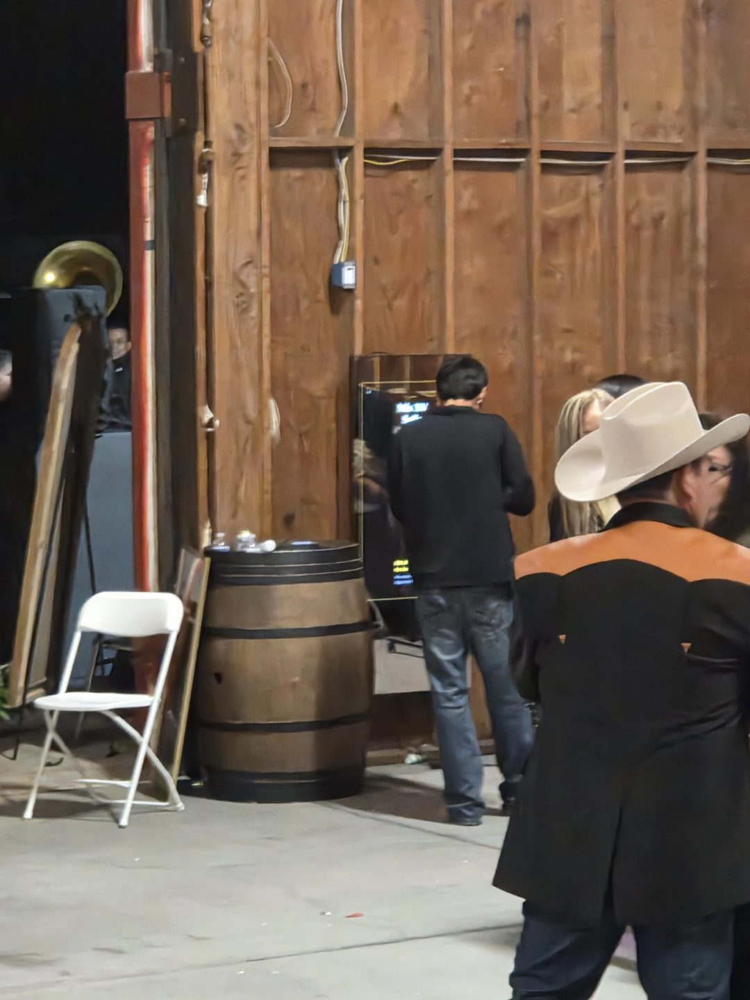
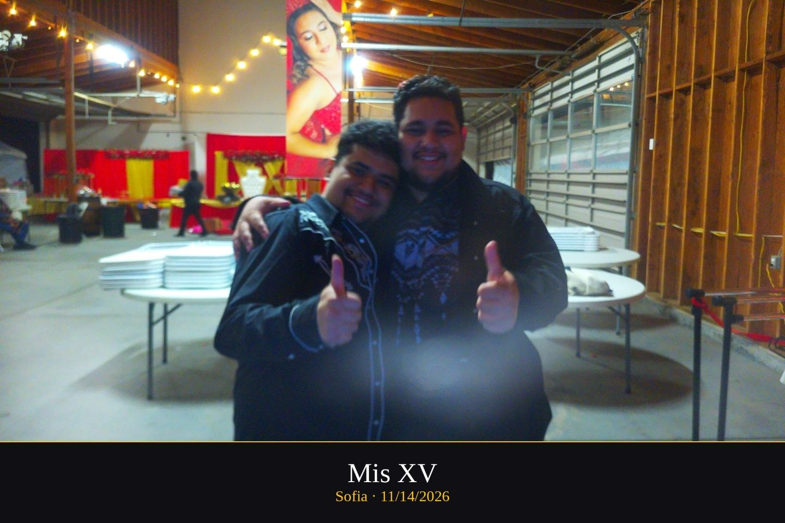
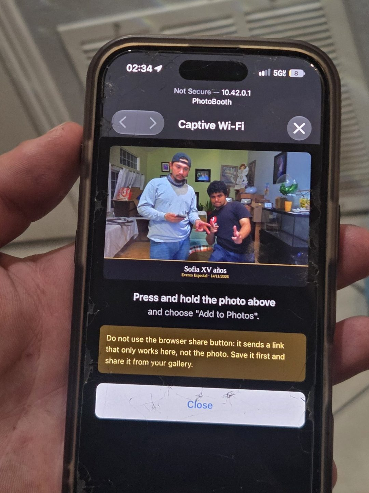
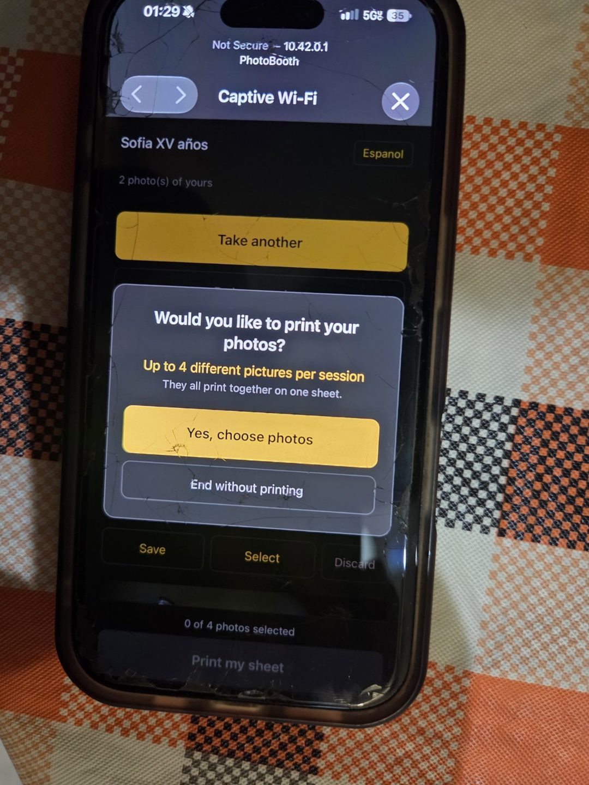

# Field photo gallery

Four photographs from the November 14, 2026 event and iPhone integration tests are published in [assets/gallery](gallery/). The photographed people approved portfolio use. The selected JPEGs were prepared for web viewing with EXIF metadata removed, and the preparation photo showing a Wi-Fi QR code was excluded.

| Evidence | Photograph | Engineering significance |
|---|---|---|
| Mirror in use during the event | [Event operation](gallery/event-field-use.jpg) | Demonstrates physical deployment and guest interaction |
| Captured, framed result | [Photograph produced by the booth](gallery/event-photo-output.jpg) | Shows the camera-to-composited-image output |
| iPhone photo-saving UI | [iOS save flow](gallery/ios-save-flow.jpg) | Shows the guest-facing photo viewer in the captive-browser environment |
| iPhone print-sheet UI | [iOS print selection](gallery/ios-print-selection.jpg) | Shows the selection workflow for up to four photographs on one sheet |

## Gallery

| Event operation | Output image |
|:---:|:---:|
|  |  |

| iPhone save flow | iPhone print selection |
|:---:|:---:|
|  |  |

These images are evidence of real-world operation and user-interface rendering. They do not, by themselves, establish exact uptime, total captures, error rates or physically completed print counts. [Field evidence notes](../docs/FIELD_EVIDENCE.md).

